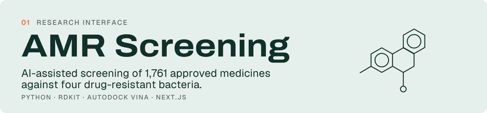
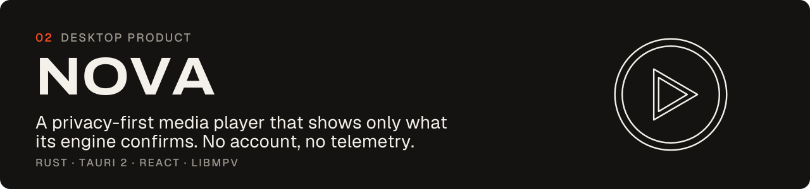
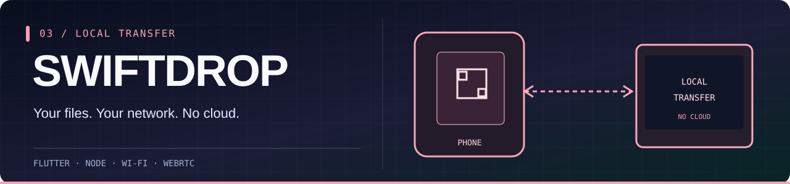

<div align="center">

<a href="https://ved.exe.snowbros.me" title="Launch the interactive developer portfolio">
  
</a>

**[SNOWBROS](https://snowbros.me)** &nbsp; / &nbsp; **[ENTER VED.EXE](https://ved.exe.snowbros.me)** &nbsp; / &nbsp; **[LINKEDIN](https://www.linkedin.com/in/ved-chauhan2107/)** &nbsp; / &nbsp; **[EMAIL](mailto:vedchauhan2107@gmail.com)**

<br/>

<sub>AHMEDABAD, INDIA &nbsp; / &nbsp; BUILDING FOR THE INTERNET &nbsp; / &nbsp; <a href="https://github.com/snowbros-labs">SNOWBROS LABS</a></sub>

</div>

---

### `01 // WHOAMI`

I'm **Ved Chauhan**, founder of **[SNOWBROS](https://snowbros.me)** — an independent software engineering studio. I work at the intersection of **deep engineering** and **expressive product design**.

I turn complex problems into usable software — from an antimicrobial-resistance research prototype to a native media engine, direct device transfer, financial ledgers, developer tools and interactive interfaces. I build both **the system and the experience**.

> **My rule:** make the core dependable, then make the experience unforgettable.

<table>
<tr><td width="33%" valign="top"><b>ENGINEER</b><p>Systems, developer tools, architecture, security, and correctness.</p></td>
<td width="33%" valign="top"><b>DESIGN</b><p>Interaction, motion, visual identity, and thoughtful details.</p></td>
<td width="34%" valign="top"><b>SHIP</b><p>Real products, real deployments, and long-term ownership.</p></td></tr>
</table>

<div align="center">

[**Explore the work ↓**](#02--selected-work) &nbsp; · &nbsp; [**See my toolbox ↓**](#03--the-toolbox) &nbsp; · &nbsp; [**Start a conversation ↓**](#05--open-channel)

</div>

---

### `02 // SELECTED WORK`

A curated engineering portfolio: research, desktop software, native tools, cross-platform apps and experimental interfaces. Each card links to source; expand the captures to see real product screens.

<a href="https://github.com/amrdrugrepurposing/amr-drug-repurposing-1"></a>

**RESEARCH PROTOTYPE** · [Research repository](https://github.com/amrdrugrepurposing/amr-drug-repurposing-1) · [Live prototype](https://amr-drug-repurposing.vercel.app)

**Computational screening for antimicrobial-resistance research.** An interdisciplinary research product joining real drug data with reproducible molecular-computation workflows.

- **Pipeline:** ChEMBL and FDA sources → RDKit/Morgan fingerprints → machine-learning benchmarking → AutoDock Vina docking → clinical-context review.
- **Quality:** source provenance, scaffold-aware validation, clear model limitations, inspectable scientific dashboard.
- **Scientific boundary:** predictions are hypotheses for experimental validation; they are **not** proof a drug treats resistant infection.

<details><summary>↳ See the real product interface</summary><br/>

<br/><sub>Capture from the <a href="https://github.com/VED2107/snowbros/tree/main/public/work">SNOWBROS studio work gallery</a></sub>
</details>

<br/>
<a href="https://github.com/VED2107/nova"></a>

**WINDOWS WORK IN PROGRESS** · [Source & status](https://github.com/VED2107/nova) · [NOVA site](https://nova.snowbros.me)

**A privacy-first media player that shows what the engine really knows.** Built with Rust, Tauri 2, React and native libmpv rendering.

- **Playback:** engine-confirmed controls, hardware-decoder fallback, frame-accurate seeking, A–B loops, and media queue.
- **Library:** local SQLite resume, background scanning, full-text search, offline operation — no account or telemetry.
- **Status:** Windows preview only; repository explicitly says it is **not ready for end users**. Mobile is experimental.

<details><summary>↳ See the real product interface</summary><br/>

<br/><sub>Capture from the <a href="https://github.com/VED2107/snowbros/tree/main/public/work">SNOWBROS studio work gallery</a></sub>
</details>

<br/>
<a href="https://github.com/VED2107/swiftdrop"></a>

**CROSS-DEVICE PRODUCT** · [Source & installation](https://github.com/VED2107/swiftdrop) · [SwiftDrop site](https://swiftdrop.snowbros.me)

**Send photos and files directly between a phone and PC over local Wi-Fi.** No cloud storage, no account and no phone installation required for the iPhone browser flow.

- **Architecture:** native Windows/Android builds, Node-based PC endpoint, browser pairing via QR and explicit PC approval.
- **Engineering:** parallel chunk transfers, streaming writes, resume and integrity tests; PC-to-phone data streams from disk.
- **Separate experiment:** a phone-to-phone path uses WebRTC; it is not the main Windows-PC transfer protocol.

<details><summary>↳ See the real product interface</summary><br/>

<br/><sub>Capture from the <a href="https://github.com/VED2107/snowbros/tree/main/public/work">SNOWBROS studio work gallery</a></sub>
</details>

<br/>
<a href="https://github.com/VED2107/accounic"></a>

**CROSS-PLATFORM RELEASE** · [Source](https://github.com/VED2107/accounic) · [Latest releases](https://github.com/VED2107/accounic/releases/latest)

**One financial ledger, three client experiences.** The database — not each client — owns every accounting balance.

- **Clients:** Next.js browser application plus Flutter Android and Windows.
- **Data contracts:** currency-of-record, FIFO settlement allocation, validated RPCs and PostgreSQL/Supabase row-level security.
- **Verification:** SQL assertions and real-HTTP tenant-isolation checks; deliberate release approvals.

<details><summary>↳ See the real product interface</summary><br/>

<br/><sub>Capture from the <a href="https://github.com/VED2107/snowbros/tree/main/public/work">SNOWBROS studio work gallery</a></sub>
</details>

<br/>
<a href="https://github.com/snowbros-labs/atlas"></a>

**OPEN SOURCE DEVELOPER TOOL** · [Source & setup](https://github.com/snowbros-labs/atlas) · [Documentation](https://github.com/snowbros-labs/atlas#contents)

**A Rust codebase analyzer for the problems that exist between files.** Shared semantic representation, evidence-backed findings and deterministic analysis.

- **Architecture:** Rust, tree-sitter, incremental caching, LSP, editor integration and SARIF reporting.
- **Coverage:** import cycles, dependency/dead-file issues and Next.js server/client boundary mistakes across JavaScript/TypeScript and Python.
- **Run:** `npx snowbros analyze`.

<details><summary>↳ See the real product interface</summary><br/>

<br/><sub>Capture from the <a href="https://github.com/VED2107/snowbros/tree/main/public/work">SNOWBROS studio work gallery</a></sub>
</details>

<br/>
<a href="https://ved.exe.snowbros.me"></a>

**INTERACTIVE PERSONAL PORTFOLIO** · [Play VED.EXE](https://ved.exe.snowbros.me) · [Source](https://github.com/VED2107/portfolio)

**A portfolio as a playable experience.** Terminal mechanics, CRT-inspired styling, RPG interactions and GSAP motion built with Next.js and TypeScript.

<br/>

<details>
<summary><b>+ UNLOCK THE REST OF THE STUDIO / PROJECT INDEX</b></summary>

<br/>

| Project | What we built | Explore |
|:--|:--|:--|
| **STC Academy** | Education site and command center for academic attendance, fees and administration. | [Source](https://github.com/VED2107/STC) |
| **Lumen TV** | Cinematic Android TV launcher, remote-first T9 search and lightweight native rendering. | [Source](https://github.com/VED2107/lumen-tv) |
| **Creative Engineering** | Open-source SNOWBROS interaction/design toolkit and live lab. | [Source](https://github.com/snowbros-labs/creative-engineering) |
| **Mentor** | Claude Code skill with focused TEACH/BUILD orchestration. | [Source](https://github.com/snowbros-labs/mentor-skill) |
| **Vinnys Vogue** | Luxury fashion storefront and order operations. | [Website](https://www.vinnysvogue.in) |
| **Lunora Studio** | Bouquet commerce experience with cinematic GSAP storytelling. | [Source](https://github.com/VED2107/lunora-studio) |
| **Filmica** | Flutter camera experience exploring film-inspired visual effects. | [Source](https://github.com/VED2107/filmica) |

</details>

#### `RESEARCH // RECOGNITION`

The AMR platform was acknowledged in a **Letter of Appreciation** by Shree S. K. Patel College of Pharmaceutical Education & Research, Ganpat University, as documented in my [LinkedIn project update](https://www.linkedin.com/in/ved-chauhan2107/). This recognizes a software engineering contribution to research — **not clinical validation** of any prediction.

### `03 // THE TOOLBOX`

**The tools change. The fundamentals don't.** I choose the stack for the problem, not the other way around.

| Layer | Tools |
|:--|:--|
| **Languages** | Rust · TypeScript · JavaScript · Python · Dart · SQL |
| **Product interfaces** | Next.js · React · Flutter · Tailwind · GSAP · shadcn/ui |
| **Backend and data** | PostgreSQL · Supabase · Node.js · Prisma · Firebase |
| **Infrastructure** | tree-sitter · Language Server Protocol · GitHub Actions · Docker |
| **Practices** | Architecture · security · testing · performance · interaction design |

<div align="center">

`RUST` · `TYPESCRIPT` · `PYTHON` · `NEXT.JS` · `REACT` · `FLUTTER` · `POSTGRESQL` · `SUPABASE` · `DOCKER`

</div>

<details>
<summary><b>+ OPEN THE ENGINEERING MANIFESTO</b></summary>

<br/>

```text
01  TRACE THE TRUTH     > Prefer evidence to guesses.
02  OWN THE CONTRACT    > Put invariants where they can be enforced.
03  DESIGN THE DETAILS  > Microinteractions are part of quality.
04  TEST THE EDGES      > Happy paths are not a test strategy.
05  SHIP & MAINTAIN     > Production is the start, not the finish.
```

</details>

---

### `04 // GITHUB SIGNAL`

<div align="center">

<a href="https://github.com/VED2107?tab=repositories">

</a>

<sub>Original SVG graphics generated by <a href="./scripts/generate_profile.py">our own source code</a> every 12 hours from GitHub's public REST API. No external stats servers or invented contributions.</sub>

</div>

<details>
<summary><b>+ EASTER EGG / THE CONTRIBUTION SNAKE</b></summary>

<br/>

<div align="center">
<picture>
<source media="(prefers-color-scheme: dark)" srcset="https://raw.githubusercontent.com/VED2107/VED2107/output/github-contribution-grid-snake-dark.svg" />
<source media="(prefers-color-scheme: light)" srcset="https://raw.githubusercontent.com/VED2107/VED2107/output/github-contribution-grid-snake.svg" />

</picture>
</div>
</details>

### `05 // OPEN CHANNEL`

**Have a difficult engineering problem, an ambitious product idea, or something that demands both logic and taste?** I build developer tools, products, and carefully designed web experiences through SNOWBROS.

<div align="center">

**[VISIT SNOWBROS](https://snowbros.me)** &nbsp; · &nbsp; **[OPEN VED.EXE](https://ved.exe.snowbros.me)** &nbsp; · &nbsp; **[LINKEDIN](https://www.linkedin.com/in/ved-chauhan2107/)** &nbsp; · &nbsp; **[EMAIL ME](mailto:vedchauhan2107@gmail.com)**

<br/>

<a href="mailto:vedchauhan2107@gmail.com"></a>

<sub>Original vector artwork, real project captures, and [reproducible GitHub signal generation](./scripts/generate_profile.py).</sub>

</div>
