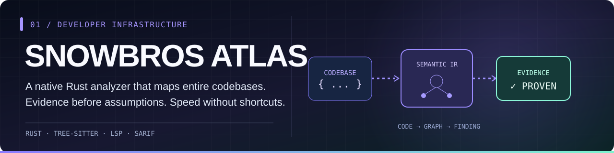
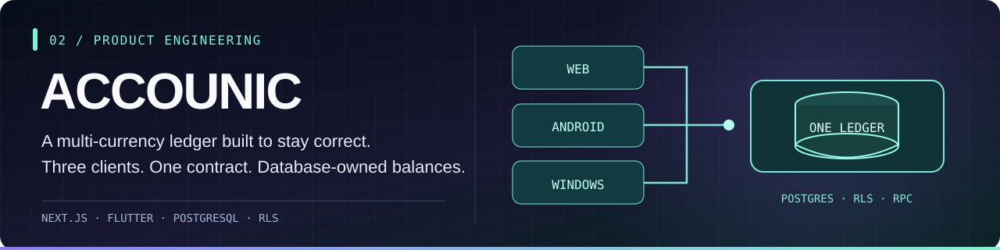
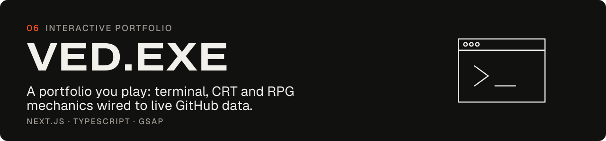
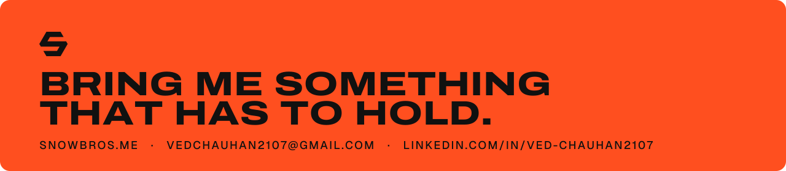

<div align="center">

<a href="https://ved.exe.snowbros.me" title="Launch the interactive developer portfolio">
  
</a>

<a href="https://snowbros.me"></a>
<a href="https://ved.exe.snowbros.me"></a>
<a href="https://www.linkedin.com/in/ved-chauhan2107/"></a>
<a href="mailto:vedchauhan2107@gmail.com"></a>

<br/>


<sub>AHMEDABAD, INDIA &nbsp; / &nbsp; BUILDING FOR THE INTERNET &nbsp; / &nbsp; <a href="https://github.com/snowbros-labs">SNOWBROS LABS</a></sub>

</div>

---

### `01 // WHOAMI`

I'm **Ved Chauhan**, founder of **[SNOWBROS](https://snowbros.me)** — an independent software engineering studio. I work at the intersection of **deep engineering** and **expressive product design**.

I build tools that understand code, products that people use, and interfaces that feel like someone cared about every detail. Sometimes that's a Rust analysis engine. Sometimes it's a cross-platform ledger. Sometimes it's a portfolio masquerading as a retro game.

> **My rule:** make the core dependable, then make the experience unforgettable.

<table>
<tr><td width="33%" valign="top"><b>ENGINEER</b><p>Systems, developer tools, architecture, security, and correctness.</p></td>
<td width="33%" valign="top"><b>DESIGN</b><p>Interaction, motion, visual identity, and thoughtful details.</p></td>
<td width="34%" valign="top"><b>SHIP</b><p>Real products, real deployments, and long-term ownership.</p></td></tr>
</table>

<div align="center">

[**Explore the work ↓**](#02--selected-work) &nbsp; · &nbsp; [**See my toolbox ↓**](#03--the-toolbox) &nbsp; · &nbsp; [**Start a conversation ↓**](#05--open-channel)

</div>

---

### `02 // SELECTED WORK`

Not a wall of logos. A few projects with real, different problems to solve.

<a href="https://github.com/snowbros-labs/atlas"></a>

**[Explore Atlas](https://github.com/snowbros-labs/atlas)** · **[Product website](https://snowbros.me/atlas)** · **[Installation](https://github.com/snowbros-labs/atlas#installation)**

**The problem:** most linters understand individual files; serious architecture issues live *between* files. Atlas maps imports, dependencies, and framework boundaries across a project, reporting findings with an evidence trail.

- **Under the hood:** Rust, tree-sitter, shared semantic intermediate representation, incremental caching, built-in LSP, and CI-ready SARIF.
- **Beyond style:** detects issues such as import cycles, unused dependencies, and Next.js server/client boundary leaks. Supports JavaScript/TypeScript and Python.
- **Try it:** `npx snowbros analyze`.

<br/>

<a href="https://github.com/VED2107/accounic"></a>

**[Explore Accounic](https://github.com/VED2107/accounic)** · **[Latest release](https://github.com/VED2107/accounic/releases/latest)**

**The problem:** money becomes unreliable when different clients each invent their own accounting rules. Accounic puts the calculations in PostgreSQL, not in the interface.

- **One contract, three clients:** Next.js web app, Flutter Android, and Flutter Windows.
- **Correctness first:** entered currency preserved, settlement rules enforced, validated RPCs, row-level security, and automated tests.
- **Design detail:** interface inspired by financial instruments — typography, seals, counterfoils, and meaningful state.

<br/>

<a href="https://ved.exe.snowbros.me"></a>

**[Launch VED.EXE](https://ved.exe.snowbros.me)** · **[Explore source](https://github.com/VED2107/portfolio)**

**The idea:** a portfolio doesn't have to feel like a static résumé. VED.EXE treats developer identity as an interactive world — CRT-inspired interfaces, terminal aesthetics, game mechanics, and expressive motion, built with Next.js, React, TypeScript, and GSAP.

<br/>

<details>
<summary><b>+ UNLOCK THE SIDE QUESTS / OTHER BUILDS</b></summary>

<br/>

| Project | What it is | Link |
|:--|:--|:--|
| **Mentor** | Engineering skill for Claude Code with focused TEACH and BUILD workflows. | [Open source](https://github.com/snowbros-labs/mentor-skill) |
| **Vinnys Vogue** | Luxury fashion commerce, orders, and storefront operations. | [Website](https://www.vinnysvogue.in) |
| **Lunora Studio** | Cinematic handmade-bouquet commerce and storytelling. | [Source](https://github.com/VED2107/lunora-studio) |
| **STC** | Student education and attendance platform. | [Source](https://github.com/VED2107/STC) |
| **Filmica** | Flutter camera experience with film-inspired effects. | [Source](https://github.com/VED2107/filmica) |

</details>

---

### `03 // THE TOOLBOX`

**The tools change. The fundamentals don't.** I choose the stack for the problem, not the other way around.

| Layer | Tools |
|:--|:--|
| **Languages** | Rust · TypeScript · JavaScript · Python · Dart · SQL |
| **Product interfaces** | Next.js · React · Flutter · Tailwind · GSAP · shadcn/ui |
| **Backend and data** | PostgreSQL · Supabase · Node.js · Prisma · Firebase |
| **Infrastructure** | tree-sitter · Language Server Protocol · GitHub Actions · Docker |
| **Practices** | Architecture · security · testing · performance · interaction design |

<div align="center">

</div>

<details>
<summary><b>+ OPEN THE ENGINEERING MANIFESTO</b></summary>

<br/>

```text
01  TRACE THE TRUTH     > Prefer evidence to guesses.
02  OWN THE CONTRACT    > Put invariants where they can be enforced.
03  DESIGN THE DETAILS  > Microinteractions are part of quality.
04  TEST THE EDGES      > Happy paths are not a test strategy.
05  SHIP & MAINTAIN     > Production is the start, not the finish.
```

</details>

---

### `04 // GITHUB SIGNAL`

<div align="center">

<a href="https://github.com/VED2107?tab=repositories"></a>
<a href="https://github.com/VED2107?tab=repositories"></a>

<sub>Automated GitHub metadata, not a score of engineering ability.</sub>

</div>

<details>
<summary><b>+ EASTER EGG / THE CONTRIBUTION SNAKE</b></summary>

<br/>

<div align="center">
<picture>
<source media="(prefers-color-scheme: dark)" srcset="https://raw.githubusercontent.com/VED2107/VED2107/output/github-contribution-grid-snake-dark.svg" />
<source media="(prefers-color-scheme: light)" srcset="https://raw.githubusercontent.com/VED2107/VED2107/output/github-contribution-grid-snake.svg" />

</picture>
</div>

</details>

---

### `05 // OPEN CHANNEL`

**Have a difficult engineering problem, an ambitious product idea, or something that demands both logic and taste?** I build developer tools, products, and carefully designed web experiences through SNOWBROS.

<div align="center">

**[VISIT SNOWBROS](https://snowbros.me)** &nbsp; · &nbsp; **[OPEN VED.EXE](https://ved.exe.snowbros.me)** &nbsp; · &nbsp; **[LINKEDIN](https://www.linkedin.com/in/ved-chauhan2107/)** &nbsp; · &nbsp; **[EMAIL ME](mailto:vedchauhan2107@gmail.com)**

<br/>

<a href="mailto:vedchauhan2107@gmail.com"></a>

<sub>Original SVG art, GitHub-native Markdown interactions, no scripts or artificial activity.</sub>

</div>
